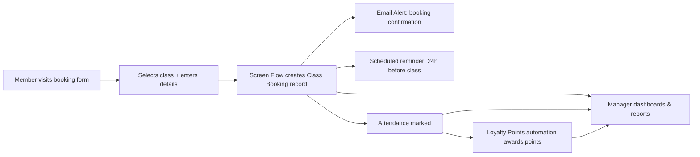

# Business Process Mapping

## As-Is (manual)

1. A member calls the studio to book a class.
2. A staff member manually enters the booking into a spreadsheet.
3. No automated confirmation is sent; reminders are often forgotten.
4. Payments and attendance are tracked manually — error-prone.

## To-Be (automated, this project)

1. A member books a class via an online form (Salesforce Flow screen).
2. A Class Booking record is created automatically in Salesforce.
3. An instant confirmation email is sent, plus a scheduled reminder the day before.
4. The class roster updates in real time.
5. Payments and loyalty points are tracked automatically.
6. Managers see live data through dashboards.

## Process diagram

